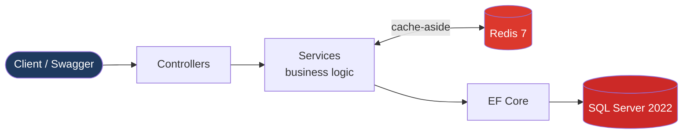
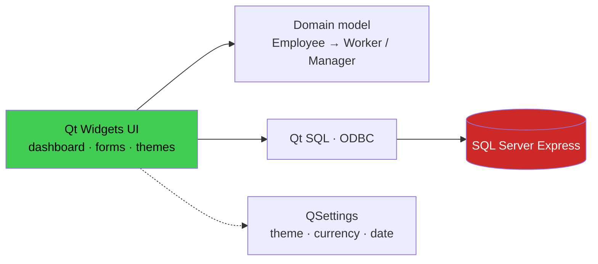
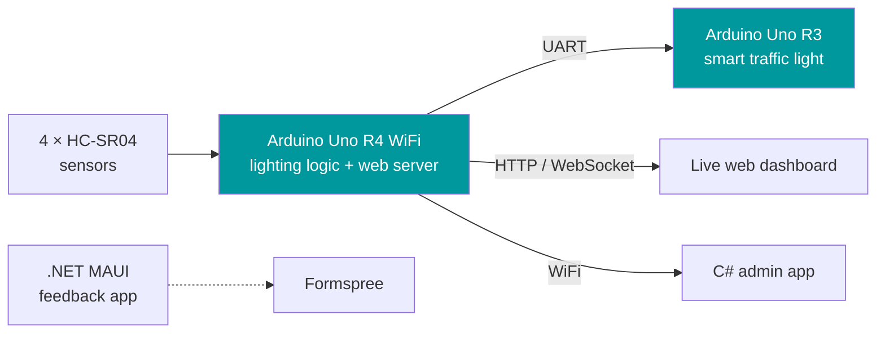

<div align="center">


<a href="https://github.com/MIhajloS07">
  
</a>

<br/><br/>

[](https://www.linkedin.com/in/mihajlo-stoiljkovic-aa1560355/)
[](https://github.com/MIhajloS07)
[](https://www.elfak.ni.ac.rs/)


<br/>

<sub>
<a href="#-featured-projects">🌟 Projects</a> &nbsp;·&nbsp;
<a href="#-tech-stack">🧰 Tech stack</a> &nbsp;·&nbsp;
<a href="#-competitions">🏆 Competitions</a> &nbsp;·&nbsp;
<a href="#-github-stats">📊 Stats</a> &nbsp;·&nbsp;
<a href="#-lets-connect">🤝 Contact</a>
</sub>

</div>

<br/>

## ⚡ In 10 seconds

<table>
<tr>
<td align="center" width="25%"><h3>🎓</h3><b>1st-year student</b><br/><sub>Electrical Engineering & Computing, University of Niš</sub></td>
<td align="center" width="25%"><h3>⚙️</h3><b>Backend</b><br/><sub>ASP.NET Core · EF Core · SQL Server · Redis · Docker · NodeJs · Flask</sub></td>
<td align="center" width="25%"><h3>🔌</h3><b>Embedded & IoT</b><br/><sub>Arduino · Raspberry Pi ·C++ · UART · WebSocket · KiCad · Linux</sub></td>
<td align="center" width="25%"><h3>🏆</h3><b>Competitor</b><br/><sub>National C++ (ZETSS), Game Jam, STEAM & more</sub></td>
</tr>
</table>

<br/>

## 👋 About me

I'm Mihajlo, a **Computer Electrical Technician** (graduate of *Rade Metalac*, Leskovac) and now a first-year student at the **Faculty of Electronic Engineering, University of Niš**.

I'm most interested in the places where layers meet: **hardware ↔ firmware ↔ backend ↔ UI**. I learn by building complete things, with tests, containers and documentation, not just code snippets.

```cs
var mihajlo = new Engineer
{
    Studies    = "Electrical Engineering & Computing @ ELFAK, Niš",
    Focus      = new[] { "Backend (ASP.NET Core)", "Embedded (Arduino)", "Desktop (C++/Qt)" },
    Philosophy = "Learn by building: with tests, containers and docs",
    Status     = "Open to internships & junior opportunities"
};
```

### 🎓 Education

| | Institution | Field |
|:--:|:--|:--|
| 🏛️ | **Faculty of Electronic Engineering, University of Niš** *(current)* | Electrical Engineering & Computing |
| 🏫 | **Technical School "Rade Metalac", Leskovac** *(graduated)* | Computer Engineering Technician |

<br/>

## 🌟 Featured projects

<div align="center">

<a href="https://github.com/MIhajloS07/Personal-Finance-Subscription-Tracker-Web-API">
  
</a>
<a href="https://github.com/MIhajloS07/WorkSphere">
  
</a>
<a href="https://github.com/MIhajloS07/Smart-City-Infrastructure-Smart-Street-Lighting-Smart-Traffic-Light">
  
</a>

</div>

<br/>

### 1️⃣ Personal Finance & Subscription Tracker API

     

A production-style **REST API** for tracking users and recurring subscriptions: multi-currency, categories, payment dates and filtering. It uses **cache-aside with Redis**, **EF Core migrations**, DTOs, health checks and Swagger docs. The whole stack starts with **one command** (`docker compose up`).



<details>
<summary><b>🔍 What's inside (click to expand)</b></summary>

<br/>

- **Architecture:** controllers → services → data layer, dependency injection, DTO pattern, SOLID
- **Data:** SQL Server 2022 with EF Core migrations, unique-email constraints, foreign keys and cascading deletes
- **Performance:** async I/O and a Redis caching layer with invalidation on updates
- **Testing:** **54 tests** (xUnit, Moq, FluentAssertions, EF Core InMemory) across services and controllers
- **DevOps:** multi-stage Dockerfile, Docker Compose (API + SQL Server + Redis), health checks, `/health` endpoint
- **API docs:** OpenAPI / Swagger UI

</details>

[](https://github.com/MIhajloS07/Personal-Finance-Subscription-Tracker-Web-API)

<br/>

### 2️⃣ WorkSphere: Desktop workforce management

   

A modern **C++17 / Qt** desktop app for managing **employees, projects and assignments**, backed by **Microsoft SQL Server**. It has a live dashboard (headcount, active projects, payroll), a polymorphic domain model (`Worker` / `Manager`), validated forms and a **dark/light theme** driven by one QSS template.



<details>
<summary><b>🔍 Highlights (click to expand)</b></summary>

<br/>

- Animated circular dashboard widgets, live search and a context-aware action bar
- Two employee types with polymorphic display, edit and payroll logic
- Projects with **auto Active/Inactive status** derived from the deadline
- Employee ↔ project assignments with duplicate detection and a live team panel
- Settings for currency (EUR, USD, RSD, BAM), date format and theme, remembered between sessions
- Parameterized queries and T-SQL; CMake build

</details>

[](https://github.com/MIhajloS07/WorkSphere)

<br/>

### 3️⃣ Smart City Infrastructure: Street Lighting & Traffic Light

    

A **team project (Team Smartanci)**: an IoT system where **four HC-SR04 ultrasonic sensors** detect vehicles and an **Arduino Uno R4 WiFi** creates a *moving corridor of light* that follows traffic, saving energy. A second **Arduino Uno R3** runs a smart traffic light over **UART**. It includes a **live web dashboard hosted on the Arduino**, a **C# admin app** and a **.NET MAUI feedback app**. It also has 3D-printed models of the traffic light and street mockup.



<details>
<summary><b>🔍 How it works (click to expand)</b></summary>

<br/>

- **Cascading light logic:** a vehicle at HC1 lights segments S1+S2, HC2 lights S2+S3, and so on, so light follows the car and stays off elsewhere
- **Protocol:** newline-terminated ASCII messages over UART (`LIGHT,S1,200`, `SENSOR,HC1,120`), with `ACK` / `ERR` handling
- **Reliability:** if WiFi drops, the traffic light falls back to a safe local timing cycle
- **Admin app (C#):** live sensor feed, manual segment control, UART monitor, event log
- **Dashboard:** street visualization, detection history, UART log viewer, AUTO / MANUAL / MAINTENANCE modes
- **Hardware design:** schematics in KiCad, assembly diagram, 3D-printed housing

</details>

[](https://github.com/MIhajloS07/Smart-City-Infrastructure-Smart-Street-Lighting-Smart-Traffic-Light)
[](https://statuesque-pudding-4a326c.netlify.app/)

<br/>

### 🗂️ More from my GitHub

<table>
<tr>
<td width="33%" valign="top">

**📡 [QtUDPServerClient](https://github.com/MIhajloS07/QtUDPServerClient)**<br/>
<sub>C++ · Qt · Winsock2</sub><br/>
UDP client-server app with a GUI and command-based communication.

</td>
<td width="33%" valign="top">

**📚 [LibrarySystem-Java](https://github.com/MIhajloS07/LibrarySystem-Java)**<br/>
<sub>Java 21 · SQLite · JUnit 5 · Maven · Docker</sub><br/>
MVC library management system with automated tests.

</td>
<td width="33%" valign="top">

**⛪ [Monastery-Web-API](https://github.com/MIhajloS07/Monastery-Web-API)**<br/>
<sub>Python · Flask · MySQL · Swagger · Docker</sub><br/>
CRUD REST API with unit tests.

</td>
</tr>
</table>

<br/>

## 🧰 Tech stack

<div align="center">


<br/>

<br/>

<br/>

</div>

<details>
<summary><b>📋 What I use each for (click to expand)</b></summary>

<br/>

| Area | Experience |
|:--|:--|
| **C# / .NET** | ASP.NET Core APIs, EF Core, WinForms, OOP, .NET MAUI basics |
| **C / C++** | Low-level fundamentals, STL, OOP, Qt Widgets, Arduino firmware |
| **Python** | Flask APIs, Raspberry Pi (`RPi.GPIO`), Pygame |
| **Java** | OOP, CRUD with database connectivity, JUnit |
| **Databases** | SQL Server (stored procedures), MySQL, SQLite, Redis caching |
| **Embedded** | Arduino, Raspberry Pi, UART, Wi-Fi / BLE, KiCad, PCB basics |
| **DevOps** | Docker, Docker Compose, Git / GitHub |
| **Game dev** | Pygame, Godot, Unity basics, GameMaker |
| **Networking & OS** | Cisco Packet Tracer, Linux / Windows administration, VMs |

*Proficiency varies across tools. This reflects hands-on projects and ongoing learning.*

</details>

<br/>

## 🏆 Competitions

<div align="center">

| | Competition | Field |
|:--:|:--|:--|
| 💻 | **ZETSS** (national) | C++ programming |
| 🎮 | **Global Game Jam** (Metropolitan) | Game development under a deadline |
| 🚀 | **Galaksija Cup** | Technical challenges |
| 🔬 | **STEAM Challenge** | Interdisciplinary team project |
| 💼 | **Business Challenge** | Teamwork & idea development |

</div>

<br/>

## 📊 GitHub stats

<div align="center">


<sub>Language stats show detected code in repositories, not proficiency.</sub>

</div>

<br/>

## 🌱 Currently learning

<div align="center">


</div>

<br/>

## 🤝 Let's connect

I'm looking for an **internship or junior role** where I can learn from experienced engineers, ship real features and grow in **backend or embedded** development.

<div align="center">

[](https://www.linkedin.com/in/mihajlo-stoiljkovic-aa1560355/)
[](https://github.com/MIhajloS07)

<br/>

**Build it. Test it. Containerize it. Learn from it.** ✨


</div>
